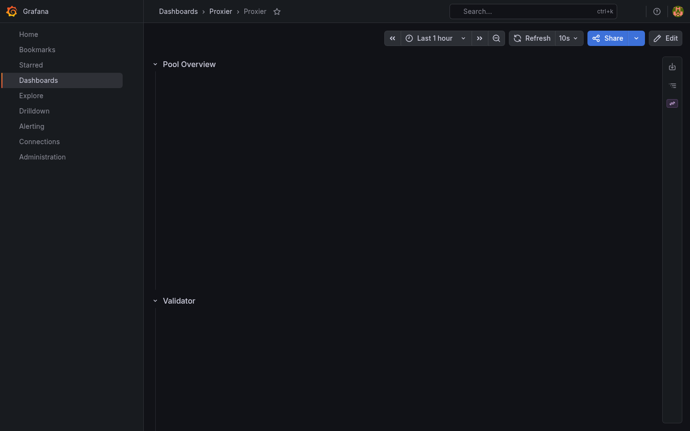

# Proxier

Lightweight Go proxy pool — scan, validate, serve. Built by [tatlilimon](https://github.com/tatlilimon).

Proxier continuously scrapes free proxy lists from 14 sources, validates each proxy in parallel, and exposes a clean REST API for IP rotation. A proxy is served only after it routed a request through itself to the probe URL over verified TLS, without revealing your own address. Use it for scraping pipelines, privacy tools, or any workflow that needs fresh proxies.

```bash
curl http://localhost:8080/proxy?protocol=socks5
# {"proxy":"socks5://1.2.3.4:1080","protocol":"socks5","latency_ms":312,"health_score":0.87,"last_checked":"..."}
```

## Quick Start

### Docker (recommended)

```bash
cp .env.example .env        # set GRAFANA_ADMIN_PASSWORD
docker compose up -d
curl http://localhost:8080/health      # {"status":"ok"}
curl http://localhost:8080/ready       # 200 once proxies can be served
curl http://localhost:8080/stats | jq  # pool stats
```

### Native

Build with Go **1.26.11 or newer**. The module requires Go 1.26, and the Go 1.25 line carries standard-library vulnerabilities that `govulncheck` reports as reachable and that are fixed only in Go 1.26. If your installed Go is older and `GOTOOLCHAIN` is `local`, run `GOTOOLCHAIN=go1.26.11 go build ...` (Go downloads that toolchain once) or install Go 1.26. The Docker image always uses the latest 1.26 patch release.

```bash
go build -o proxier ./cmd/proxier/
./proxier            # reads ./config.yaml if present
```

### Customize

Override any config value via environment variables:

```bash
docker run -p 127.0.0.1:9090:9090 \
  -e HOST=0.0.0.0 \
  -e PORT=9090 \
  -e SCANNER_MODE=continuous \
  -e SCANNER_CONTINUOUS_DELAY_SEC=30 \
  -e CHANNEL_BUFFER_SIZE=10000 \
  -e KEEPALIVE_WORKERS=4 \
  -e VALIDATOR_WORKERS=50 \
  proxier
```

By default the server binds to `127.0.0.1` (localhost only). Set `HOST=0.0.0.0` to listen on all interfaces — useful inside Docker for inter-container communication. The API has no authentication (see Non-Goals): keep it on loopback or behind a reverse proxy.

## Configuration

Three layers apply in order, later ones winning:

1. **Built-in defaults** (in the code),
2. **`config.yaml`** in the working directory (optional),
3. **environment variables**.

The merged result is validated once at startup. Any invalid value — an out-of-range number, an unknown mode, a malformed URL, or an environment variable that is set but not a valid number or boolean — stops the process with a message naming every problem (exit code 2). Nothing silently falls back.

| Variable | YAML key | Built-in default | `config.yaml` | `docker-compose.yml` | Description |
|---|---|---|---|---|---|
| `HOST` | `server.host` | `127.0.0.1` | `127.0.0.1` | `0.0.0.0` | Address to bind the HTTP server to |
| `PORT` | `server.port` | `8080` | `8080` | `8080` | HTTP server port |
| `CHANNEL_BUFFER_SIZE` | `server.channel_buffer_size` | `2000` | `2000` | `10000` | Capacity of the check queue between the scheduler and the workers |
| `SCANNER_MODE` | `scanner.mode` | `interval` | `interval` | `continuous` | `interval` or `continuous` |
| `SCANNER_INTERVAL_SEC` | `scanner.interval_sec` | `600` | `600` | — | Fetch interval in interval mode |
| `SCANNER_CONTINUOUS_DELAY_SEC` | `scanner.continuous_delay_sec` | `30` | `30` | `30` | Pause after each cycle in continuous mode |
| `SCANNER_DEDUP_TTL_SEC` | `scanner.dedup_ttl_sec` | `1800` | `1800` | — | How long a listed proxy is not re-offered |
| `VALIDATOR_WORKERS` | `validator.workers` | `20` | `100` | — | Concurrent check workers |
| `VALIDATOR_TIMEOUT_MS` | `validator.timeout_ms` | `10000` | `5000` | `2000` | Per-check timeout |
| `VALIDATOR_PROBE_URL` | `validator.probe_url` | `https://httpbin.org/ip` | `https://httpbin.org/ip` | `https://httpbin.org/ip` | httpbin-style endpoint returning `{"origin": "..."}` (or `{"ip": "..."}`) |
| `KEEPALIVE_INTERVAL_SEC` | `validator.keepalive_interval_sec` | `300` | `120` | — | Recheck interval for ALIVE proxies |
| `MAX_CONSECUTIVE_FAILS` | `validator.max_consecutive_fails` | `5` | `3` | — | Consecutive failures before DEAD |
| `KEEPALIVE_WORKERS` | `validator.keepalive_workers` | `0` | `0` | `4` | Extra workers reserved for ALIVE rechecks |
| `KEEPALIVE_USE_MAIN_CHANNEL` | `validator.keepalive_use_main_channel` | `false` | `false` | `true` | Let ALIVE rechecks overflow into the main workers when the reserved ones are busy |
| `ALLOW_PRIVATE_PROXIES` | `validator.allow_private_proxies` | `false` | `false` | — | Allow proxies on loopback, private, link-local and other non-public addresses |
| `EXTRA_CA_FILE` | `validator.extra_ca_file` | — | — | — | PEM file with extra trusted roots for TLS verification |
| `STORAGE_BACKEND` | `storage.backend` | `sqlite` | `sqlite` | — | Only `sqlite` is supported |
| `STORAGE_PATH` | `storage.path` | `./proxies.db` | `./proxies.db` | `/data/proxies.db` | SQLite file |
| `DEAD_RETENTION_HOURS` | `storage.dead_retention_hours` | `24` | — | — | Remove DEAD records this long after they died (`0` keeps them) |
| `LOG_LEVEL` | `log_level` | `info` | — | `info` | `debug`, `info`, `warn`, `error` |
| `PROXY_SOURCES` | — | — | — | — | Comma-separated TXT/HTTP source URLs to append |

## Performance Tuning

The default settings favor safety over speed. For maximum throughput, enable continuous mode and reserved keepalive workers:

```yaml
# docker-compose.yml overrides
environment:
  - SCANNER_MODE=continuous
  - SCANNER_CONTINUOUS_DELAY_SEC=30
  - CHANNEL_BUFFER_SIZE=10000
  - KEEPALIVE_WORKERS=4
```

### Scanner Mode

Both modes fetch up to five sources in parallel.

- **`interval`** (default): fetches on a fixed timer (`SCANNER_INTERVAL_SEC`). `next_run` is the next tick.
- **`continuous`**: fetches, then waits `SCANNER_CONTINUOUS_DELAY_SEC` after the cycle completes. `next_run` is end of cycle plus the delay.

### Scheduling and Workers

Every record carries the time of its next check. Once a second a scheduler moves due records into the check queue, most important first: ALIVE rechecks, then proxies that worked before, new candidates, retries of never-working proxies, and DEAD retries last. A record is checked by one worker at a time and is never queued twice, so a large failing backlog cannot starve rechecks of working proxies.

`CHANNEL_BUFFER_SIZE` is the capacity of that queue. Candidates are never dropped: the scanner stores them in the pool, and they wait there as `discovered` until a worker is free.

`KEEPALIVE_WORKERS` adds workers that only recheck ALIVE proxies. With `KEEPALIVE_USE_MAIN_CHANNEL=true` an ALIVE recheck that finds them busy goes to the main workers instead. Without reserved workers, ALIVE rechecks use the main workers.

### Adding Sources

```yaml
# config.yaml
scanner:
  sources:
    - url: "https://api.proxyscrape.com/v4/free-proxy-list/get?request=getproxies&protocol=http&limit=2000"
      format: txt
      protocol: http
    - url: "https://raw.githubusercontent.com/TheSpeedX/PROXY-List/master/socks5.txt"
      format: txt
      protocol: socks5
```

- **`txt`**: one proxy per line, `host:port` (IPv6 in brackets, `[2001:db8::1]:8080`) or `scheme://host:port`. Anything after the address on the line is ignored, as are empty lines and `#` comments. A scheme on the line wins over the source protocol.
- **`json`**: an array of objects with `ip` or `host`, `port`, and optionally `protocol`.
- Protocols: `http`, `https`, `socks4`, `socks5`, and `mixed` for sources that list several kinds. In a `mixed` source a line without a scheme is tried as `http`, `socks4` and `socks5` (three candidates).

A proxy's identity is protocol, host and port: the same address listed as HTTP and as SOCKS5 is two records.

Candidates on loopback, private, link-local, shared (CGNAT), reserved or multicast addresses are refused unless `ALLOW_PRIVATE_PROXIES=true`; `/stats` counts them as `scanner.rejected`.

## API

Base URL: `http://localhost:8080`

### `GET /proxy`

Returns one working proxy — weighted random selection favoring higher health scores.

| Param | Type | Default | Description |
|---|---|---|---|
| `format` | string | `url` | `url` or `hostport` |
| `protocol` | string | `any` | `http`, `https`, `socks4`, `socks5` |
| `max_latency_ms` | int | — | Max acceptable latency |

```json
{
  "proxy": "http://123.45.67.89:8080",
  "protocol": "http",
  "latency_ms": 312,
  "health_score": 0.87,
  "last_checked": "2026-05-15T14:22:00Z"
}
```

`country` is part of the response format but is not populated: Proxier does not geolocate proxies, and the field is omitted when empty. Proxier also does not classify anonymity levels; it verifies that the probe does not see your own address (see Validation).

No match returns `503` with `{"error":"no proxy available: ..."}`.

### `GET /proxies`

Returns multiple proxies. Limits are capped at 100.

| Param | Type | Default | Description |
|---|---|---|---|
| `limit` | int | `10` | Max results |
| `sort` | string | `random` | `random`, `latency`, `health_score` |

Supports the same `format`, `protocol`, and `max_latency_ms` filters as `/proxy`.

### `GET /rotate`

Round-robin over the ALIVE pool. Same query params as `/proxy`.

### `GET /stats`

Live runtime statistics.

<details>
<summary>Example response</summary>

```json
{
  "pool": {
    "total": 1003, "alive": 142, "validating": 38, "dead": 417, "discovered": 406,
    "dead_last_hour": 23, "avg_health_score": 0.64,
    "protocols": { "http": 98, "socks5": 44 }
  },
  "scanner": {
    "sources_count": 14, "sources_ok": 13,
    "last_fetch_count": 43200, "last_new_count": 310,
    "total_discovered": 21500, "last_duration_ms": 3800,
    "dropped": 0, "rejected": 12,
    "last_run": "2026-05-24T10:00:00Z", "next_run": "2026-05-24T10:10:00Z",
    "sources": [
      { "url": "https://...", "protocol": "http", "ok": true, "last_attempt": "...", "last_success": "...", "last_count": 2000 }
    ]
  },
  "validator": {
    "workers": 104, "total_checks": 1580,
    "success_count": 142, "failure_count": 1438,
    "success_rate_pct": 8.9, "avg_latency_ms": 388,
    "indeterminate_count": 0, "in_flight": 37, "queue_depth": 120,
    "failure_reasons": { "timeout": 900, "connect_failed": 420, "tls_error": 80, "leaks_client_ip": 38 },
    "routing_baseline_known": true
  },
  "storage": { "pending": 12, "failures": 0, "last_success": "2026-05-24T10:00:05Z" },
  "uptime": "2h3m15s",
  "version": "1.5.0"
}
```

</details>

- `pool.validating`: out of rotation, waiting for another check (after a failure, after a restart, or because its last success is stale). `pool.discovered`: candidates waiting for their first check.
- `scanner.last_fetch_count`: candidates parsed in the last cycle, before deduplication; `last_new_count` and `total_discovered`: records actually added to the pool.
- `scanner.dropped` is always 0 and kept for compatibility.
- `validator.avg_latency_ms`: mean latency of successful checks.
- `validator.indeterminate_count`: checks that could not be judged because your own address (the routing baseline) was unknown.

### `GET /health`

Liveness probe — returns 200 even with an empty pool.

```json
{ "status": "ok" }
```

### `GET /ready`

Readiness probe — 200 only when at least one proxy is ALIVE and leak detection is available; otherwise 503 with the reasons.

```json
{ "ready": false, "reasons": ["no alive proxies"] }
```

### `POST /validate`

Test a specific proxy on demand, with exactly the same checks as background validation. The result does not change the pool.

```bash
curl -X POST http://localhost:8080/validate \
  -H "Content-Type: application/json" \
  -d '{"proxy":"socks5://123.45.67.89:1080"}'
```

```json
{ "proxy": "socks5://123.45.67.89:1080", "alive": false, "latency_ms": 2001, "reason": "timeout" }
```

- Input: `host:port` (HTTP) or `scheme://host:port` with `http`, `https`, `socks4` (`socks4a`) or `socks5` (`socks5h`); port 1–65535; no credentials, path or query.
- Loopback, private and other non-public proxy addresses return 400 unless `ALLOW_PRIVATE_PROXIES=true`. Host names are checked again after DNS resolution.
- The body is limited to 4 KiB; at most 8 validations run at once (429 beyond that).
- `reason` is one of `unsupported_protocol`, `disallowed_address`, `connect_failed`, `timeout`, `tls_error`, `bad_status`, `redirect`, `invalid_probe_response`, `leaks_client_ip`, or `routing_unverified` (your own address is not known yet).

### `GET /metrics`

Prometheus exposition format, produced by the official Go client: every metric family is defined once, and the latency histogram records real observations. The output passes `promlint` (the checks `promtool check metrics` applies); a test enforces this.

| Metric | Type | Description |
|---|---|---|
| `proxier_pool_records` | gauge | Proxy records of any state |
| `proxier_pool_alive` | gauge | Proxies in rotation |
| `proxier_pool_validating` | gauge | Out of rotation, waiting for another check |
| `proxier_pool_dead` | gauge | Dead proxies |
| `proxier_pool_discovered` | gauge | Candidates waiting for their first check |
| `proxier_pool_dead_last_hour` | gauge | Became dead in the last hour |
| `proxier_pool_avg_health_score` | gauge | Average health score of alive proxies |
| `proxier_pool_alive_by_protocol{protocol}` | gauge | Alive proxies per protocol |
| `proxier_validator_workers` | gauge | Validation workers |
| `proxier_validator_checks_total` | counter | Completed checks |
| `proxier_validator_success_total` | counter | Successful checks |
| `proxier_validator_failure_total` | counter | Failed checks |
| `proxier_validator_failures_by_reason_total{reason}` | counter | Failed checks by reason |
| `proxier_validator_indeterminate_total` | counter | Checks not judged (routing baseline unknown) |
| `proxier_validator_success_rate_pct` | gauge | Success rate since start |
| `proxier_validator_avg_latency_seconds` | gauge | Mean latency of successful checks |
| `proxier_validator_success_latency_seconds` | histogram | Latency of successful checks |
| `proxier_validator_in_flight` | gauge | Checks running now |
| `proxier_validator_queue_depth` | gauge | Checks scheduled but not started |
| `proxier_validator_routing_baseline_known` | gauge | 1 when leak detection is available |
| `proxier_scanner_sources` | gauge | Configured sources |
| `proxier_scanner_sources_ok` | gauge | Sources whose last fetch succeeded |
| `proxier_scanner_source_up{source}` | gauge | 1 when the source's last fetch succeeded |
| `proxier_scanner_source_last_success_timestamp_seconds{source}` | gauge | Last successful fetch of the source |
| `proxier_scanner_source_last_fetched{source}` | gauge | Candidates in the source's last fetch |
| `proxier_scanner_last_fetched` | gauge | Candidates parsed in the last cycle |
| `proxier_scanner_last_new` | gauge | Records the last cycle added |
| `proxier_scanner_discovered_total` | counter | Unique records added to the pool |
| `proxier_scanner_rejected_total` | counter | Candidates refused by the address policy |
| `proxier_scanner_dropped_total` | counter | Always 0 (compatibility) |
| `proxier_scanner_last_duration_seconds` | gauge | Duration of the last scan cycle |
| `proxier_scanner_last_run_timestamp_seconds` | gauge | Start of the last scan cycle |
| `proxier_storage_pending` | gauge | Changes not yet written to storage |
| `proxier_storage_failures_total` | counter | Failed storage writes |
| `proxier_storage_last_success_timestamp_seconds` | gauge | Last successful storage write |
| `proxier_uptime_seconds` | gauge | Process uptime |

## Monitoring (Prometheus + Grafana)

`docker compose up -d` starts three services:

| Service | Port | Description |
|---|---|---|
| **proxier** | `:8080` | Proxy pool API + `/metrics` endpoint |
| **prometheus** | `:9090` | Scrapes `/metrics` every 15s, 7-day retention (pinned `v3.13.2`) |
| **grafana** | `:3000` | Pre-configured dashboard (pinned `13.1.3`), data kept in the `grafana_data` volume |

```
http://localhost:3000   →  Grafana (admin / the GRAFANA_ADMIN_PASSWORD from .env)
http://localhost:9090   →  Prometheus UI
http://localhost:8080   →  Proxier API
```



The Grafana dashboard auto-loads from `grafana/dashboards/proxier.json` and covers pool overview, protocol distribution, validator throughput (checks per minute), success rate, latency percentiles from the histogram, and source health. All panels refresh every 10 seconds. Each service has a 512 MB memory limit and rotated logs (3 × 10 MB).

## Architecture

```
  Sources (14)                          Workers
      |                                    ^
      v                                    | due records, most important first
  Scanner ----> Pool (in-memory) ----> Scheduler (1 s)
 (parallel)      |   ^                     
                 |   | results applied to the canonical record
                 |   +------------------ Checker (probe through the proxy)
                 v
          Storage (SQLite, acknowledged writes every 5 s)
                 |
                 v
          REST API (:8080)  /proxy /proxies /rotate /stats /health /ready /validate /metrics
```

- **Scanner** — fetches the lists (five at a time), drops candidates seen within the dedup TTL, stores the rest in the pool, and only then marks them seen. Never validates.
- **Pool** — owns every record. Readers get copies; every change goes through the pool under its lock with the previous state known, so the counters always equal a census of the records and only ALIVE records are selectable. Weighted random selection, round-robin and protocol/latency filters.
- **Scheduler and workers** — see "Scheduling and Workers". A check interrupted by shutdown changes nothing.
- **Checker** — one engine for background validation and `/validate` (see Validation).
- **Storage** — SQLite (pure Go, no CGO) in WAL mode. Every 5 seconds the changed records are written in one transaction and marked clean only after the commit, so a failed write is retried and a change made during a write is not lost. Shutdown stops the API, cancels in-flight checks (a cancelled check changes nothing) and waits for every worker, then writes the final state.

## Validation

A check passes only if every step holds:

1. The proxy address is allowed by the address policy (also checked after DNS resolution).
2. The connection works: HTTP proxies via absolute-form requests or CONNECT, `https` proxies over verified TLS, SOCKS4/4a and SOCKS5 with remote DNS. Handshakes honour the timeout and cancellation.
3. TLS to the probe is verified with the system roots (plus `EXTRA_CA_FILE`). A proxy that intercepts TLS fails.
4. The probe answers 2xx without a redirect, with a JSON body of at most 64 KiB whose `origin` lists valid IP addresses.
5. None of those addresses is your own. Proxier learns your address (the routing baseline) by asking the probe directly at startup; it retries with backoff until it succeeds and refreshes it every 30 minutes. Until then results are *indeterminate*: neither success nor failure, and nothing is promoted to ALIVE.

Use an `https` probe URL: over plain HTTP a proxy can forge the probe's answer (Proxier logs a warning).

## Proxy Lifecycle

```
  DISCOVERED --success--> ALIVE <--success-- VALIDATING
      |                     |                    |  ^
      +------failure------> | --failure--------->+  | stale / restart
                            +--------------------+--+
  VALIDATING --max_consecutive_fails--> DEAD --3 spaced retries, or listed again--> check
```

| State | Meaning |
|---|---|
| `DISCOVERED` | Candidate waiting for its first check. |
| `VALIDATING` | Out of rotation. Failed its last check (retried with backoff), was loaded after a restart without a recent success, or its last success is older than three keepalive intervals. |
| `ALIVE` | Passed its last check. Available via `/proxy`, `/proxies`, `/rotate`. Rechecked every keepalive interval. |
| `DEAD` | Failed `MAX_CONSECUTIVE_FAILS` times in a row. Retried after 1, 3 and 8 keepalive intervals, and again whenever a source lists it. Removed after `DEAD_RETENTION_HOURS`. |

Freshness bound: an ALIVE proxy was confirmed at most one keepalive interval plus one check ago when rechecks keep up; if they fall behind by more than three intervals it leaves rotation until rechecked.

### Health Score

Each ALIVE proxy carries a score (`0.0`–`1.0`) used for weighted selection:

- Latency — 1.0 at <=100ms, linear ramp to 0 at >=5000ms (x0.4 weight)
- Success streak — `min(consecutive_ok / 10, 1.0)` (x0.6 weight); any failure resets the streak

## Upgrading from 1.4

- **Database**: the first start migrates the SQLite file to schema version 1 in one transaction (three new columns; records are re-keyed because the protocol is now part of a proxy's identity). Back up `proxies.db` first. An older build can still read the migrated file but would store duplicate rows; restore the backup to roll back.
- **Metrics renamed** for Prometheus naming rules (the bundled dashboard is updated):

  | 1.4 | 1.5 |
  |---|---|
  | `proxier_pool_total` | `proxier_pool_records` |
  | `proxier_pool_protocol_count` | `proxier_pool_alive_by_protocol` |
  | `proxier_validator_avg_latency_ms` | `proxier_validator_avg_latency_seconds` |
  | `proxier_validator_latency_ms` (synthetic histogram) | `proxier_validator_success_latency_seconds` (real) |
  | `proxier_scanner_last_fetch_count` | `proxier_scanner_last_fetched` |
  | `proxier_scanner_last_duration_ms` | `proxier_scanner_last_duration_seconds` |

- **Private proxy addresses** are refused by default; set `ALLOW_PRIVATE_PROXIES=true` if you rely on them.
- **`STORAGE_BACKEND=json`** was never implemented and is now rejected at startup; `REDIS_URL` is ignored.
- **Grafana** needs `GRAFANA_ADMIN_PASSWORD` in `.env`.
- **Invalid configuration** now stops startup instead of falling back.

## Development

```bash
go vet ./...
go test -race ./...
```

The tests use local fixtures only (no network): an httpbin-style probe, HTTP/CONNECT, SOCKS4 and SOCKS5 proxies and misbehaving variants in `internal/fakeproxy`. Each fixture dials upstream from its own address in `127.0.0.0/8`, which Linux routes to loopback. `cmd/proxier` contains an end-to-end test that runs the whole service — scanning, validation, API, persistence, restart. `docs/AUDIT-FIXES.md` maps every finding of the September 2026 audit to its fix and test.

## Source List

The default config ships with 14 sources:

| Category | Sources |
|---|---|
| Direct APIs | ProxyScrape v4, OpenProxyList.xyz |
| GitHub Lists | TheSpeedX/PROXY-List, monosans/proxy-list, jetkai/proxy-list, sunny9577/proxy-scraper, hookzof/socks5_list |

Sources are fetched in parallel. Failed sources are skipped — the service continues with whatever is available — and reported per source in `/stats` and `/metrics`.

## Non-Goals

- Authentication / API keys (deploy behind a reverse proxy)
- Proxy chaining
- Paid proxy support
- Browser fingerprinting
